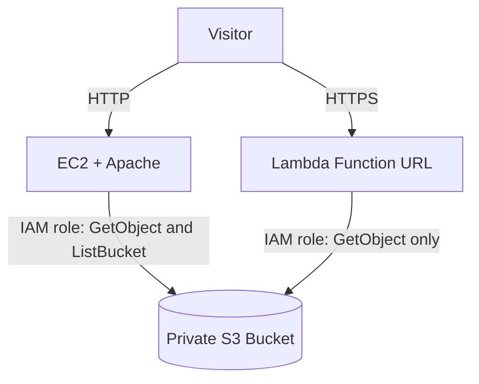

# Lab 7 — Host Your CV on AWS

**Name:** Eishah Iqbal  
**Roll Number:** 23L-2587  
**Region:** ap-southeast-2 (Sydney)

## Architecture



### Request flow

For EC2, the visitor opens the public IPv4 address, Apache serves the locally synchronized CV files, and a systemd timer refreshes those files from the private S3 bucket every five minutes.

For Lambda, the visitor opens the public HTTPS function URL, the function reads the requested file from the private S3 bucket using its IAM role, and returns the appropriate response.

## Deployment addresses

- **EC2:** http://3.107.152.166/
- **Lambda:** https://7auc6j2fkwob7kz2hcmmbf47ji0lqmbn.lambda-url.ap-southeast-2.on.aws/
- **S3 bucket:** `cv-23l-2587-582129522828-ap-southeast-2-an`

## Access-denied test

The EC2 instance attempted to delete an object from the private S3 bucket. The request failed with `AccessDenied` because the EC2 IAM role does not have permission to perform `s3:DeleteObject`.

```text
aws s3 rm s3://cv-23l-2587-582129522828-ap-southeast-2-an/site/index.html
delete failed: s3://cv-23l-2587-582129522828-ap-southeast-2-an/site/index.html An error occurred (AccessDenied) when calling the DeleteObject operation: User: arn:aws:sts::582129522828:assumed-role/cv-ec2-role-23l-2587/i-05f3084c5f0b204e3 is not authorized to perform: s3:DeleteObject on resource: "arn:aws:s3:::cv-23l-2587-582129522828-ap-southeast-2-an/site/index.html" because no identity-based policy allows the s3:DeleteObject action
```

## EC2 synchronization log

The EC2 systemd timer runs the synchronization service every five minutes to refresh the website files from S3. The log records the execution timestamp, status, and EC2 instance ID.

These are the actual successful log entries available from the captured output. The capture contains ten entries; no log entries have been fabricated.

```text
2026-10-23T16:15:24+00:00 status=SUCCESS instance=i-05f3084c5f0b204e3
2026-10-23T16:19:45+00:00 status=SUCCESS instance=i-05f3084c5f0b204e3
2026-10-23T16:24:52+00:00 status=SUCCESS instance=i-05f3084c5f0b204e3
2026-10-23T16:29:52+00:00 status=SUCCESS instance=i-05f3084c5f0b204e3
2026-10-23T16:34:52+00:00 status=SUCCESS instance=i-05f3084c5f0b204e3
2026-10-23T16:39:52+00:00 status=SUCCESS instance=i-05f3084c5f0b204e3
2026-10-23T16:44:52+00:00 status=SUCCESS instance=i-05f3084c5f0b204e3
2026-10-23T16:49:52+00:00 status=SUCCESS instance=i-05f3084c5f0b204e3
2026-10-23T16:54:52+00:00 status=SUCCESS instance=i-05f3084c5f0b204e3
2026-10-23T16:59:52+00:00 status=SUCCESS instance=i-05f3084c5f0b204e3
```

## Written answers

### 1. Why use IAM roles instead of access keys?

EC2 and Lambda use IAM roles to obtain temporary credentials automatically, avoiding long-lived access keys in source code or configuration. If keys were placed in user data, they could be exposed through instance metadata, logs, or access to instance configuration. Roles also allow permissions to be restricted and changed centrally.

### 2. What happens when someone opens the direct S3 address?

The request receives Access Denied because the bucket is private. S3 Block Public Access and the absence of a public bucket policy or public ACL prevent anonymous access. Only the permitted IAM roles can read the specified objects.

### 3. What does the public Lambda URL permission do?

The function URL's resource-based permission allows unauthenticated visitors to invoke the Lambda function. This is acceptable here because the function is deliberately serving a public CV. It does not make the S3 bucket public, and the function's execution role has read-only access to the required objects.

### 4. How do the EC2 and Lambda costs compare?

EC2 incurs instance and storage costs while resources are provisioned, even when nobody visits the site; a public IPv4 address may also incur charges. Lambda generally charges for requests and execution, so an idle function can cost less, subject to applicable free allowances and other charges. Lambda can scale automatically with traffic within service quotas, while a single EC2 instance may become overloaded and require additional capacity.

### 5. What happens if the EC2 instance is deleted?

The instance's local web files, local logs, and instance-specific public IP are lost, depending on storage and termination settings. The original CV files remain in S3, and the Lambda function, GitHub repository, and IAM roles remain unless separately deleted. The EC2 website will no longer work until another server is deployed.

## Evidence

The generated `evidence.txt` contains the AWS account, bucket security, versioning, object, IAM policy, security group, instance, endpoint, Lambda log, and log-retention results.

The endpoint tests returned HTTP 200 for the EC2 website, CSS, and PDF, and for the Lambda website, CSS, and PDF. The invalid Lambda path returned HTTP 404, while direct S3 access returned HTTP 403, as expected for a private bucket.

The security group permits public HTTP traffic on port 80 and restricts SSH access on port 22 to `154.208.34.218/32`. S3 Block Public Access is enabled, bucket versioning is enabled, and Lambda log retention is set to seven days.

## Adaptations and references

AWS documentation and course lab instructions were used as references for configuring S3, EC2, IAM roles, Lambda, and CloudWatch logging. AI assistance was used to understand the configuration steps and troubleshoot errors. All configurations and scripts were tested in the AWS environment, and the results were verified using the generated evidence.